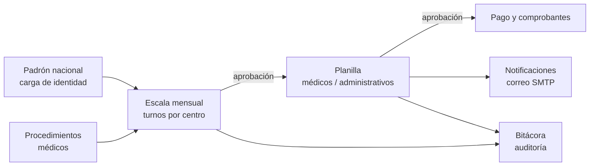

# MediCore-HA

### Oracle 21c Data Guard + plataforma de gestión para centros de salud


> Un sistema de nómina clínica que no puede permitirse perder un solo dato, desplegado sobre una arquitectura de alta disponibilidad real.

**ES** — Plataforma de gestión para centros de salud construida sobre Oracle Database 21c, con replicación síncrona a un standby mediante Oracle Data Guard e infraestructura reproducible con Vagrant.
**EN** — Healthcare operations and payroll platform on Oracle 21c, replicated to a standby with zero data loss through Oracle Data Guard, on reproducible Vagrant infrastructure.

---

## ¿Qué es esto?

El repositorio reúne dos piezas que normalmente se estudian por separado:

1. **Un sistema de negocio completo en PL/SQL**: centros de salud, personal médico y administrativo, turnos, escalas mensuales, procedimientos, planillas, pagos, seguridad por roles, auditoría y notificaciones por correo.
2. **Una infraestructura de alta disponibilidad**: dos servidores Oracle 21c en Oracle Linux 8, configurados en modo `MAXAVAILABILITY` con transporte `FASTSYNC`, Data Guard Broker, Flashback, backups RMAN y monitoreo automatizado.

Las dos piezas son independientes. El esquema de negocio vive en `1-BD/` y la infraestructura en `2-Standby/`, que incluye su propio esquema de prueba para validar la replicación sin depender del sistema clínico.

---

## Lo que demuestra el proyecto

| Área | Qué encontrarás |
| --- | --- |
| **Dominio real** | Modelo de datos de 27 tablas para operación clínica y nómina, con reglas de negocio implementadas en procedimientos y paquetes PL/SQL. |
| **Seguridad** | RBAC con roles `Administrator`, `Medic` y `Administrative`, perfiles de contraseña, activación de rol por sesión y cifrado AES-256 con `DBMS_CRYPTO`. |
| **Nómina** | Generación de planillas por tipo, mes y año combinando procedimientos médicos, turnos trabajados y salario base, con movimientos automáticos y aprobación en dos etapas. |
| **Alta disponibilidad** | Data Guard síncrono con RPO 0, switchover y failover documentados paso a paso, protección ante pérdida de redo y verificación de lag. |
| **Infraestructura como código** | Dos VMs definidas en `Vagrantfile`, configuración centralizada en YAML/env y despliegue orquestado con PowerShell en un solo comando. |
| **Operación** | Backups RMAN diarios, limpieza de archivos, verificación de transporte de logs, jobs de mantenimiento y notificaciones HTML por SMTP. |
| **Documentación** | Manual técnico en LaTeX/PDF, guías de switchover y failover, y scripts de compilación del PDF. |

---

## Arquitectura


| Componente | Detalle |
| --- | --- |
| Motor | Oracle Database 21c Enterprise, arquitectura multitenant (CDB + PDB) |
| Protección | `MAXAVAILABILITY` + `FASTSYNC`, lag objetivo de 300 s |
| Recuperación | Flashback habilitado en ambos nodos, backups RMAN con retención configurable |
| Red | Red privada VirtualBox `192.168.56.0/24`, puertos reenviados al host |
| Aprovisionamiento | Vagrant + VirtualBox + provisión shell por nodo |

---

## Flujo funcional



El ciclo operativo completo: se cargan los datos del personal y el padrón, se construyen los turnos y la escala del mes, se registran los procedimientos realizados, se generan las planillas, se aprueban y finalmente se emiten los pagos y comprobantes con notificación al empleado.

---

## Módulos del sistema de salud

| Módulo | Responsabilidad |
| --- | --- |
| **Seguridad y acceso** | Roles, permisos por pantalla, perfiles de contraseña y activación de rol al iniciar sesión. |
| **Centros y personal** | Centros de salud, cargos, usuarios, cuentas bancarias y documentos solicitados. |
| **Padrón nacional** | Carga y validación de identidad desde archivo mediante directorio Oracle. |
| **Escalas y turnos** | Escala base, generación de escala mensual, estados del turno y aprobación para pago. |
| **Procedimientos** | Registro de procedimientos con precio para el centro, ingreso del médico y control de procesamiento. |
| **Planillas** | Generación por tipo/mes/año, cálculo por hora o turno completo, salario base, movimientos automáticos con límites y totales. |
| **Pagos** | Aprobación de planilla, generación de pago, comprobantes y marcado de notificación/depósito. |
| **Notificaciones** | Paquete SMTP con ACL de red, plantillas HTML y envío desde jobs programados. |
| **Auditoría** | Bitácora alimentada por triggers y parámetros generales versionados. |
| **Mantenimiento** | Jobs para cuentas inactivas, tablespaces al 85 %, objetos inválidos e índices dañados. |

---

## Alta disponibilidad y operación

| Capacidad | Implementación |
| --- | --- |
| Replicación síncrona | Data Guard `MAXAVAILABILITY` / `FASTSYNC` con RPO 0 |
| Cambio de rol planificado | `DGMGRL_SWITCHOVER_GUIDE.md` |
| Recuperación ante desastre | `DGMGRL_FAILOVER_GUIDE.md` |
| Backups | `rman_daily_backup.sh`, `manual_backup.sh`, retención configurable |
| Monitoreo | `verify_dataguard.sh`, `check_log_transport.sh`, alertas por correo |
| Limpieza | `delete_archives_primary.sh` y `delete_archives_standby.sh` vía cron |
| Validación | Esquema `dgtest` con tablas, secuencias y procedimientos para comprobar replicación |

---

## Stack tecnológico

| Capa | Tecnologías |
| --- | --- |
| Base de datos | Oracle Database 21c Enterprise, PL/SQL, CDB/PDB |
| Alta disponibilidad | Oracle Data Guard, Data Guard Broker (DGMGRL), Flashback, RMAN |
| Sistema operativo | Oracle Linux 8 |
| Virtualización | Vagrant, VirtualBox, discos VDI dedicados para `u01` y `u02` |
| Automatización | PowerShell 5.1+, Bash, cron, SQL*Plus |
| Servicios Oracle | `DBMS_CRYPTO`, `DBMS_NETWORK_ACL_ADMIN`, `DBMS_SCHEDULER`, `UTL_SMTP`, `DBMS_OUTPUT` |
| Documentación | LaTeX, PDF, Markdown |

---

## Estructura del repositorio

```text
.
├── 1-BD/                     # Esquema y lógica de negocio en PL/SQL
│   ├── ScriptProyectoBD*.SQL # Tablas, secuencias, constraints y triggers
│   ├── Payrolls/             # Generación, aprobación y pago de planillas
│   ├── MonthScales/          # Generación y aprobación de escalas mensuales
│   ├── NationalRegister/     # Carga del padrón nacional
│   ├── Security/             # Roles, perfiles y gestión de contraseñas
│   ├── Notifications/        # Jobs de mantenimiento y alertas
│   ├── LogBooks/             # Bitácora y triggers de auditoría
│   ├── Emails/               # Paquete de envío SMTP
│   └── Encryption/           # Funciones de cifrado y descifrado
├── 2-Standby/                # Infraestructura Data Guard (independiente)
│   ├── schema/               # Esquema de prueba de replicación
│   ├── scripts/              # Provisión de primary, standby y opcionales
│   ├── automation/           # Backups, cron, monitoreo y verificación
│   └── infrastructure/       # SO, discos, red e instalación de Oracle
├── config/                   # vagrant.yml e install.env
├── powershell/               # deploy.ps1, destroy.ps1, fix-line-endings.ps1
├── guia_standby_latex/       # Manual técnico y PDF compilado
├── software/                 # Oracle DB Home (no versionado)
├── Vagrantfile               # Definición de las dos VMs
└── DGMGRL_*_GUIDE.md         # Guías de switchover y failover
```

---

## Modelo de datos

27 tablas, 22 secuencias, 42 triggers y 30 claves foráneas cubren seguridad, personal, centros, turnos, procedimientos, planillas, movimientos, pagos y auditoría.

<p align="center">
  
</p>

---

## Inicio rápido

### Requisitos

- Windows 10/11 en el host (flujo probado con PowerShell).
- VirtualBox 7.x y Vagrant 2.3+.
- Al menos 8 GB de RAM libre para las dos VMs (4 GB cada una).
- Espacio en disco para los discos virtuales de `u01` y `u02`.
- `LINUX.X64_213000_db_home.zip` de Oracle 21c dentro de `software/` (no se versiona por tamaño).

### Despliegue

```powershell
git clone <url-del-repositorio>
cd mediocore-ha

# Copia el DB Home de Oracle 21c en software/
# Ajusta credenciales y rutas en config/install.env

.\powershell\deploy.ps1
```

| Fase | Acción | Duración aproximada |
| --- | --- | --- |
| 1 | Verificación de prerrequisitos | — |
| 2 | Normalización de finales de línea | — |
| 3 | Limpieza de VMs obsoletas | — |
| 4 | Despliegue del primario | 30–45 min |
| 5 | Despliegue del standby y Data Guard | 20–30 min |
| 5.5 | Verificación posterior | — |
| 6 | Recolección de logs | — |

### Conexiones

| Servicio | Host | Puerto | Servicio Oracle |
| --- | --- | --- | --- |
| Primario CDB | `localhost` | `15210` | `cdb1` |
| Primario PDB | `localhost` | `15210` | `pdb1` |
| Standby CDB | `localhost` | `15220` | `cdb1_stby` |
| Esquema de prueba | `localhost` | `15210` | `pdb1` (usuario `dgtest`) |

Las credenciales se definen en `config/install.env`. Cámbialas antes de cualquier despliegue.

---

## Verificación de replicación

**1. Insertar datos en el primario**

```sql
CONNECT dgtest/<password>@localhost:15210/pdb1

DECLARE
  v_id NUMBER;
BEGIN
  insert_test_data('Smoke test', 'Verificación de Data Guard', v_id);
  DBMS_OUTPUT.PUT_LINE('Registro creado: ' || v_id);
END;
/
```

**2. Confirmar en el standby (solo lectura)**

```sql
CONNECT dgtest/<password>@localhost:15220/pdb1

SET SERVEROUTPUT ON
SELECT id, test_name, created_on_db, created_at
FROM replication_test
ORDER BY created_at DESC;

EXEC check_replication_status;
```

**3. Revisar el estado del transporte y el lag**

```bash
vagrant ssh primary
/home/oracle/automation/verify_dataguard.sh
/home/oracle/automation/check_log_transport.sh
```

---

## Documentación

| Documento | Contenido |
| --- | --- |
| [`guia_standby_latex/StandbyGuide.pdf`](guia_standby_latex/StandbyGuide.pdf) | Manual completo de instalación, operación y recuperación |
| [`guia_standby_latex/StandbyGuide.tex`](guia_standby_latex/StandbyGuide.tex) | Fuente LaTeX del manual |
| [`DGMGRL_SWITCHOVER_GUIDE.md`](DGMGRL_SWITCHOVER_GUIDE.md) | Cambio de rol planificado con el Broker |
| [`DGMGRL_FAILOVER_GUIDE.md`](DGMGRL_FAILOVER_GUIDE.md) | Recuperación ante fallo del primario |
| [`CLAUDE.md`](CLAUDE.md) | Guía técnica del repositorio para agentes y colaboradores |
---