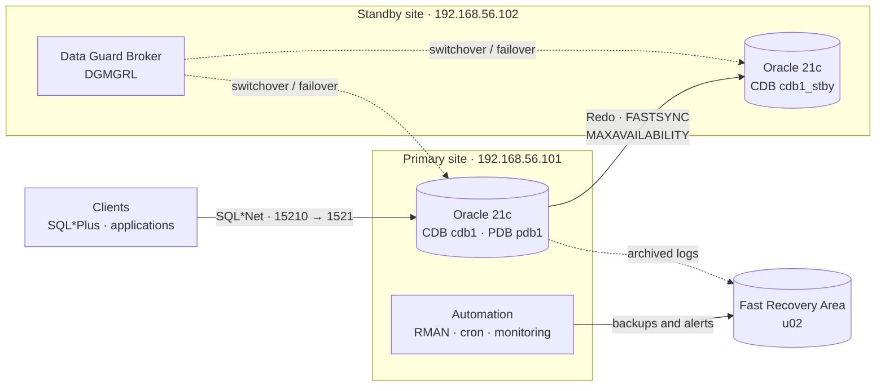
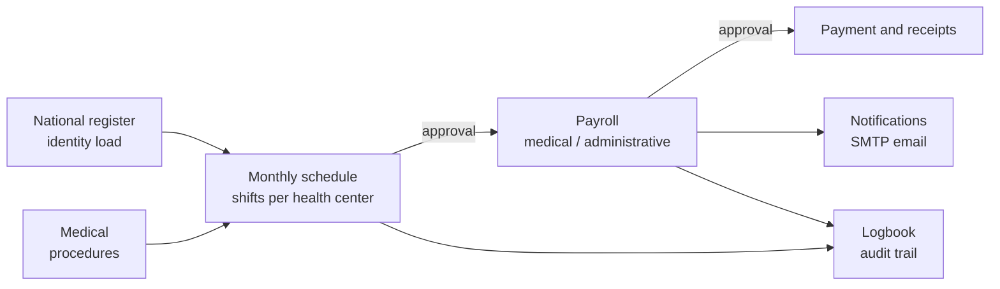
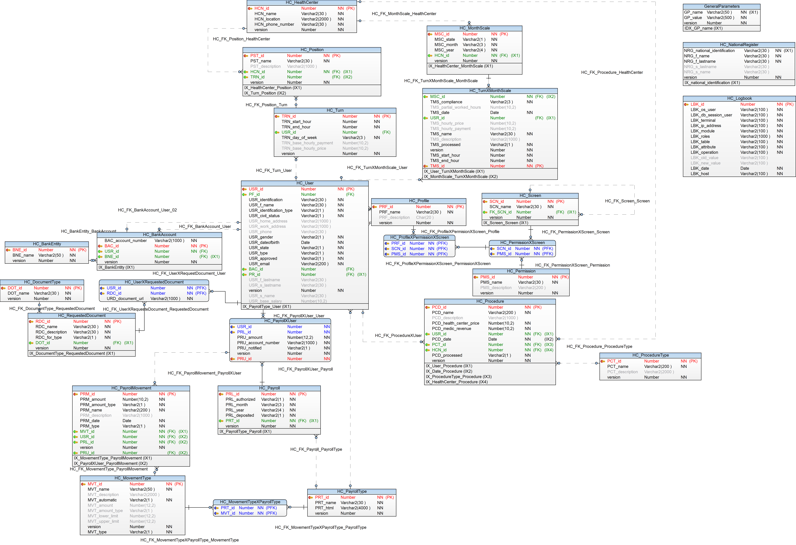

### Oracle 21c Data Guard + healthcare operations platform


> A clinical payroll system that cannot afford to lose a single record, deployed on a real high-availability architecture.

— Healthcare operations and payroll platform built on Oracle Database 21c, with synchronous replication to a standby through Oracle Data Guard and reproducible Vagrant infrastructure.

---

## What is this?

The repository combines two pieces that are usually studied separately:

1. **A complete business system in PL/SQL**: health centers, medical and administrative staff, shifts, monthly schedules, medical procedures, payroll, payments, role-based security, auditing, and email notifications.
2. **A high-availability infrastructure**: two Oracle 21c servers on Oracle Linux 8 configured in `MAXAVAILABILITY` mode with `FASTSYNC` transport, Data Guard Broker, Flashback, RMAN backups, and automated monitoring.

The two pieces are independent. The business schema lives in `1-BD/`, while the infrastructure lives in `2-Standby/`, which ships its own test schema to validate replication without depending on the clinical system.

---

## What this project demonstrates

| Area | What you will find |
| --- | --- |
| **Real domain** | A 27-table data model for clinical operations and payroll, with business rules implemented in PL/SQL procedures and packages. |
| **Security** | RBAC with `Administrator`, `Medic`, and `Administrative` roles, password profiles, per-session role activation, and AES-256 encryption through `DBMS_CRYPTO`. |
| **Payroll** | Payroll generation by type, month, and year, combining medical procedures, worked shifts, and base salary, with automatic movements and two-stage approval. |
| **High availability** | Synchronous Data Guard with RPO 0, documented switchover and failover, redo-loss protection, and lag verification. |
| **Infrastructure as code** | Two VMs defined in a `Vagrantfile`, centralized YAML/env configuration, and one-command deployment orchestration with PowerShell. |
| **Operations** | Daily RMAN backups, archive cleanup, log transport checks, maintenance jobs, and HTML email alerts over SMTP. |
| **Documentation** | A LaTeX/PDF technical manual, switchover and failover guides, and PDF build scripts. |

---

## Architecture



| Component | Detail |
| --- | --- |
| Engine | Oracle Database 21c Enterprise, multitenant architecture (CDB + PDB) |
| Protection | `MAXAVAILABILITY` + `FASTSYNC`, 300 s lag target |
| Recovery | Flashback enabled on both nodes, RMAN backups with configurable retention |
| Network | VirtualBox private network `192.168.56.0/24`, ports forwarded to the host |
| Provisioning | Vagrant + VirtualBox + per-node shell provisioning |

---

## Business flow



The full operating cycle: staff and national-register data are loaded, shifts and the monthly schedule are built, performed procedures are recorded, payrolls are generated and approved, and payments plus receipts are issued with an employee notification.

---

## Healthcare modules

| Module | Responsibility |
| --- | --- |
| **Security and access** | Roles, screen-level permissions, password profiles, and role activation at login. |
| **Centers and staff** | Health centers, positions, users, bank accounts, and requested documents. |
| **National register** | Identity loading and validation from a file through an Oracle directory. |
| **Schedules and shifts** | Base schedule, monthly schedule generation, shift states, and approval for payment. |
| **Procedures** | Procedure recording with health-center price, physician revenue, and processing control. |
| **Payroll** | Generation by type/month/year, hourly or full-shift calculation, base salary, automatic movements with limits, and totals. |
| **Payments** | Payroll approval, payment generation, receipts, and notification/deposit flags. |
| **Notifications** | SMTP package with a network ACL, HTML templates, and scheduled job delivery. |
| **Auditing** | Logbook populated by triggers and versioned general parameters. |
| **Maintenance** | Jobs for inactive accounts, tablespaces above 85%, invalid objects, and damaged indexes. |

---

## High availability and operations

| Capability | Implementation |
| --- | --- |
| Synchronous replication | Data Guard `MAXAVAILABILITY` / `FASTSYNC` with RPO 0 |
| Planned role change | `DGMGRL_SWITCHOVER_GUIDE.md` |
| Disaster recovery | `DGMGRL_FAILOVER_GUIDE.md` |
| Backups | `rman_daily_backup.sh`, `manual_backup.sh`, configurable retention |
| Monitoring | `verify_dataguard.sh`, `check_log_transport.sh`, email alerts |
| Cleanup | `delete_archives_primary.sh` and `delete_archives_standby.sh` via cron |
| Validation | `dgtest` schema with tables, sequences, and procedures to verify replication |

---

## Technology stack

| Layer | Technologies |
| --- | --- |
| Database | Oracle Database 21c Enterprise, PL/SQL, CDB/PDB |
| High availability | Oracle Data Guard, Data Guard Broker (DGMGRL), Flashback, RMAN |
| Operating system | Oracle Linux 8 |
| Virtualization | Vagrant, VirtualBox, dedicated VDI disks for `u01` and `u02` |
| Automation | PowerShell 5.1+, Bash, cron, SQL*Plus |
| Oracle services | `DBMS_CRYPTO`, `DBMS_NETWORK_ACL_ADMIN`, `DBMS_SCHEDULER`, `UTL_SMTP`, `DBMS_OUTPUT` |
| Documentation | LaTeX, PDF, Markdown |

---

## Repository structure

```text
.
├── 1-BD/                     # Business schema and PL/SQL logic
│   ├── ScriptProyectoBD*.SQL # Tables, sequences, constraints, and triggers
│   ├── Payrolls/             # Payroll generation, approval, and payment
│   ├── MonthScales/          # Monthly schedule generation and approval
│   ├── NationalRegister/     # National register loading
│   ├── Security/             # Roles, profiles, and password management
│   ├── Notifications/        # Maintenance jobs and alerts
│   ├── LogBooks/             # Logbook and audit triggers
│   ├── Emails/               # SMTP email package
│   └── Encryption/           # Encryption and decryption functions
├── 2-Standby/                # Data Guard infrastructure (standalone)
│   ├── schema/               # Replication test schema
│   ├── scripts/              # Primary, standby, and optional provisioners
│   ├── automation/           # Backups, cron, monitoring, and verification
│   └── infrastructure/       # OS, disks, network, and Oracle installation
├── config/                   # vagrant.yml and install.env
├── powershell/               # deploy.ps1, destroy.ps1, fix-line-endings.ps1
├── guia_standby_latex/       # Technical manual and compiled PDF
├── software/                 # Oracle DB Home (not versioned)
├── Vagrantfile               # Both VM definitions
└── DGMGRL_*_GUIDE.md         # Switchover and failover guides
```

---

## Data model

27 tables, 22 sequences, 42 triggers, and 30 foreign keys cover security, staff, health centers, shifts, procedures, payroll, movements, payments, and auditing.

<p align="center">
  
</p>

---

## Quick start

### Requirements

- Windows 10/11 host (the PowerShell flow is the tested path).
- VirtualBox 7.x and Vagrant 2.3+.
- At least 8 GB of free RAM for both VMs (4 GB each).
- Disk space for the `u01` and `u02` virtual disks.
- Oracle 21c `LINUX.X64_213000_db_home.zip` inside `software/` (not versioned because of its size).

### Deployment

```powershell
git clone <repository-url>
cd medicore-ha

# Place the Oracle 21c DB Home inside software/
# Adjust credentials and paths in config/install.env

.\powershell\deploy.ps1
```

| Phase | Action | Approximate duration |
| --- | --- | --- |
| 1 | Prerequisite checks | — |
| 2 | Line-ending normalization | — |
| 3 | Stale VM cleanup | — |
| 4 | Primary deployment | 30–45 min |
| 5 | Standby deployment and Data Guard setup | 20–30 min |
| 5.5 | Post-deployment verification | — |
| 6 | Log collection | — |

### Connections

| Service | Host | Port | Oracle service |
| --- | --- | --- | --- |
| Primary CDB | `localhost` | `15210` | `cdb1` |
| Primary PDB | `localhost` | `15210` | `pdb1` |
| Standby CDB | `localhost` | `15220` | `cdb1_stby` |
| Test schema | `localhost` | `15210` | `pdb1` (user `dgtest`) |

Credentials are defined in `config/install.env`. Change them before any deployment.

---

## Replication verification

**1. Insert data on the primary**

```sql
CONNECT dgtest/<password>@localhost:15210/pdb1

DECLARE
  v_id NUMBER;
BEGIN
  insert_test_data('Smoke test', 'Data Guard verification', v_id);
  DBMS_OUTPUT.PUT_LINE('Created record: ' || v_id);
END;
/
```

**2. Confirm on the standby (read-only)**

```sql
CONNECT dgtest/<password>@localhost:15220/pdb1

SET SERVEROUTPUT ON
SELECT id, test_name, created_on_db, created_at
FROM replication_test
ORDER BY created_at DESC;

EXEC check_replication_status;
```

**3. Check transport status and lag**

```bash
vagrant ssh primary
/home/oracle/automation/verify_dataguard.sh
/home/oracle/automation/check_log_transport.sh
```

---

## Documentation

| Document | Content |
| --- | --- |
| [`guia_standby_latex/StandbyGuide.pdf`](guia_standby_latex/StandbyGuide.pdf) | Complete installation, operation, and recovery manual |
| [`guia_standby_latex/StandbyGuide.tex`](guia_standby_latex/StandbyGuide.tex) | LaTeX source of the manual |
| [`DGMGRL_SWITCHOVER_GUIDE.md`](DGMGRL_SWITCHOVER_GUIDE.md) | Planned role change with the Broker |
| [`DGMGRL_FAILOVER_GUIDE.md`](DGMGRL_FAILOVER_GUIDE.md) | Recovery from primary failure |
| [`CLAUDE.md`](CLAUDE.md) | Technical repository guide for agents and contributors |

---